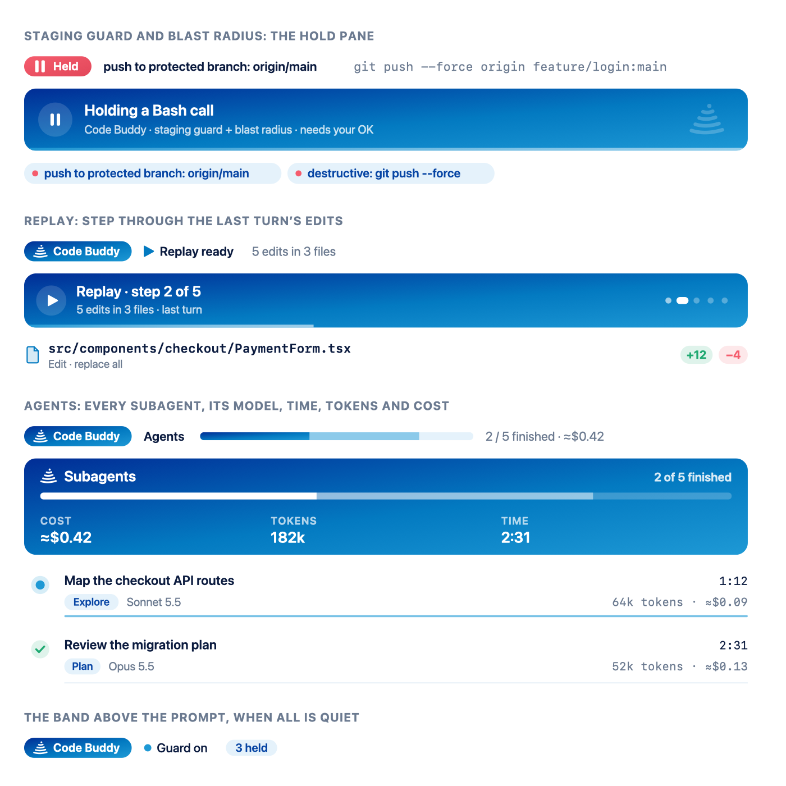

# Code Buddy

A Claude Code mod that keeps an eye on what Claude does for you. One plugin, five features:

1. **Staging guard.** Holds a tool call before it runs when it targets one of your production domains, carries a live Stripe key, pushes or merges into your protected branch, or deploys (`vercel --prod`, `terraform apply`, `cdk deploy`, `kubectl apply`, `docker push`).
2. **Blast radius.** Holds destructive shell commands (`rm -r`/`-f`, `git reset --hard`, `git checkout -- .`, `git restore .`, `git clean`, force pushes, database migrations) and shows what they would delete or change before you decide.
3. **Replay.** Records every file edit in a turn without changing it. After the turn, step through the diffs with Prev, Next and Close.
4. **Agents panel.** Tracks every subagent: description, model, status, elapsed time, tokens and estimated cost, with a progress bar of finished out of total. Each running subagent shows what it is doing right now (`Read · src/api/routes.ts`, step and tool counts). The panel opens by itself when a second subagent starts in a turn, has a compact one-line-per-subagent view, and can warn you when subagents pass a cost budget. **Details ›** on any subagent shows everything about it: its full task, model and effort, what it is doing now, tokens and cost by kind, context size, a timeline of its tool calls (✓ ok, ✗ error, ⏸ held), tools used, files changed and read, commands run, its latest message or final report (with Copy buttons), and how it runs (background, fork, parent, folder, permissions).

5. **Control panel.** Pause any feature for a while (Pause 30m), for the session (Pause), or switch it off in every session (Turn off), and edit the settings, from one pane: `/code-buddy control`. A paused feature shows in the band with a **Resume** button, and timed pauses end by themselves.

It draws in the terminal and in the Claude desktop app's Code tab, in light and dark mode.

<picture>
  <source media="(prefers-color-scheme: dark)" srcset="docs/preview-dark.png">
  
</picture>

## Install

In a Claude Code terminal session:

```
/plugin install code-buddy --marketplace RuahTechSolutions/code-buddy
```

Answer `y` to add the marketplace, pick a scope (user scope loads it everywhere, including the desktop app's Code tab), and fill in the settings screen. You can change any setting later with `/code-buddy config`.

## Settings

| Setting | What it does | Default |
| --- | --- | --- |
| Production domains | Comma-separated hosts. `*.example.com` matches every subdomain. Shell commands, web requests and browser calls that target one are held. | empty (rule off) |
| Staging domains | Hosts that are let through. **Production wins on overlap:** only an exact host listed here (no wildcard) is let through. | empty |
| Protected branch | Pushes to it and merges into it are held. Comma-separated; `*` matches within a name. | `main` |
| Staging guard | Feature 1 on or off in every session. | on |
| Blast radius | Feature 2 on or off in every session. | on |
| Replay | Feature 3 on or off in every session. | on |
| Agents panel | Feature 4 on or off in every session. | on |
| Holds (master switch) | Off turns off both hold features at once (the older `guard` setting). | on |
| Subagent budget | Estimated subagent spend per session, in USD. Past it you get one toast, and the agents bar, the panel's budget tile and the idle band turn coral. `0` or `off` turns it off. | off |
| Auto-open agents panel | Opens the agents panel by itself when a second subagent starts in a turn, once per turn, so closing it sticks. | on |

```
/code-buddy config production example.com, *.example.com
/code-buddy config staging staging.example.com
/code-buddy config branch main, release/*
/code-buddy config guard off
/code-buddy config budget 2.50
/code-buddy config autoopen off
/code-buddy config blast off
```

Every setting can also be changed in the control panel (`/code-buddy control`): edit a field and press Enter.

## Commands

| Command | What it does |
| --- | --- |
| `/code-buddy` | Status, settings, and this session's held calls with their outcomes. |
| `/code-buddy:code-buddy` | The same command, from the plugin's command file. The desktop app's `/` menu lists this one before a session has started; it answers exactly like `/code-buddy`. |
| `/code-buddy replay` | Opens the replay of the last turn's edits. |
| `/code-buddy agents` | Opens or closes the agents panel (also the band's **Agents** button, hotkey `a`). Inside it, **Compact** / **Expand** (hotkey `x`) switches between full rows and one line per subagent. |
| `/code-buddy config` | Shows the settings, or changes one. |
| `/code-buddy control` | Opens the control panel (also `/code-buddy settings`, and `/code-buddy pause` with nothing after it). |
| `/code-buddy pause <feature> [time]` | Pauses `guard`, `blast`, `replay`, `agents` or `all` for this session: `30m`, `2h`, `90s`, or until resumed. |
| `/code-buddy resume [feature]` | Resumes one feature, or everything paused. |

## How a hold works

- One pane for the guard and blast radius: the rule that matched, the command, what it would affect, and **Proceed** and **Cancel**. Cancel has the focus.
- Holds queue, so only one shows at a time.
- A held call is refused if nobody answers within 10 minutes, if the turn is interrupted, or straight away in a non-interactive run (such as `claude -p`).
- Claude is told why a call was refused and not to retry it unless you ask.

## The band above the prompt

One band, shared by all four features, shows the most important thing first: a waiting hold, then the agents progress bar, then the replay hint, then `Code Buddy · guard on · N held`.

## Privacy

- **No network requests, no model calls, no environment variables.** Everything it measures comes from local commands such as `git status`, `git log`, `git clean -n` and `du`. Migrations are listed from files on disk, never by connecting to the database.
- **Keys are masked.** Stripe, GitHub, Slack, AWS, Google, npm and model-provider keys, bearer tokens, JWTs, private keys and `secret=`/`token=` values show only their first 8 characters, on screen and in anything stored.
- **Costs are estimates** from each model's list price. The engine reports tokens, not money.

## Development

```
git clone https://github.com/RuahTechSolutions/code-buddy
claude --plugin-dir ./code-buddy
```

- `claude plugin test ./code-buddy` runs the tests (125 across 9 files).
- `claude plugin validate ./code-buddy` checks the manifest, the marketplace file and the hooks module.

The plugin is a Claude Code function-hooks module: `hooks/register.tsx` is the only file that calls the engine. `guard.ts`, `blast.ts`, `diff.ts` and `mask.ts` are pure logic. `features.ts` handles pauses. `hold.tsx`, `replay.tsx`, `agents.tsx`, `detail.tsx`, `control.tsx` and `theme.ts` draw.

## Credits and licence

Apache License 2.0; see [LICENSE](LICENSE). Code Buddy adapts code and ideas from [blast-radius and replay-theater](https://github.com/anthropics/claude-code-playground) (Apache-2.0, Anthropic PBC) and [savvy-progress](https://github.com/johnnyvizz/claude-kit) (MIT). See [NOTICE](NOTICE) for what was adapted and where.

---

Made by [Ruah Tech Solutions](https://github.com/RuahTechSolutions). Powered by [www.Ruah.ai](https://www.ruah.ai).
